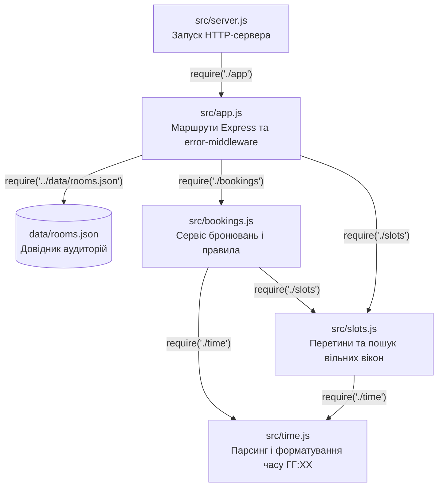

# Архітектура проєкту `room-booking`

## Рівень 1 — Контекст системи

Сервіс `room-booking` надає JSON HTTP API для керування розкладом зайнятості аудиторій навчального закладу:

- **Користувачі / клієнти:** диспетчер розкладу, викладачі або зовнішні вебінтерфейси коледжу, що звертаються до API по HTTP.
- **Джерело аудиторій:** статичний довідник [data/rooms.json](../data/rooms.json), який підвантажується під час ініціалізації `createApp()` (у тестах може передаватися власний список аудиторій).
- **Зовнішні інтеграції:** відсутні; стан бронювань зберігається в оперативній пам’яті процесу.

## Рівень 2 — Складові частини та залежності модулів

Діаграма відображає фактичні залежності між модулями, перевірені за викликами `require(...)` у коді `src/` та `tests/`:

## Ключовий сценарій: `POST /api/bookings`

1. Клієнт надсилає JSON `{ roomId, date, from, to, who }` на `POST /api/bookings`.
2. Проміжний обробник `express.json()` (`src/app.js:18`) розбирає тіло запиту в `req.body`.
3. Обробник маршруту (`src/app.js:32–34`) передає `req.body` у `service.create(req.body)`.
4. `findRoom(roomId)` (`src/bookings.js:76–80`) перевіряє наявність аудиторії (інакше кидає `httpError(404)`).
5. `toMinutes(from)` та `toMinutes(to)` (`src/time.js:16–20`) конвертують рядки `"ГГ:ХХ"` у хвилини доби (`RangeError`, якщо формат хибний).
6. Виконуються бізнес-перевірки в `create()` (`src/bookings.js:103–112`):
   - `end <= start` → HTTP `400`;
   - вихід за робочі години `[room.opens, room.closes]` → HTTP `400`;
   - тривалість `> MAX_BOOKING_HOURS * 60` → HTTP `400`;
   - перетин через `overlaps()` (`src/slots.js:33–35`) із будь-яким бронюванням з `this.list(roomId, date)` → HTTP `409`.
7. Запис `{ id: nextId++, roomId, date, from, to, who }` додається до масиву `bookings` у пам’яті й повертається зі статусом `201`.
8. Усі винятки передаються в фінальний error-middleware (`src/app.js:41–43`), який відповідає `err.status || 500`.

## Записи архітектурних рішень (ADR)

- [ADR-0001: Зберігання бронювань у пам’яті процесу](./adr/0001-in-memory-storage.md)
- [ADR-0002: Напіввідкриті інтервали часу для бронювань і слотів](./adr/0002-half-open-time-intervals.md)
